## Abstract

Aceasta lucrare propune o metoda adaptiva de reducere a zgomotului din imaginile medicale, avand ca obiectiv conservarea structurilor anatomice fine. Metoda utilizeaza o harta statistica de probabilitate anatomica pentru a ajusta spatial intensitatea filtrarii Gaussian, fara utilizarea retelelor neuronale.

Evaluarea experimentala a fost realizata pe seturile de date Duke OCT si DRIVE, utilizand si adnotarile RITE, urmarind conservarea stratului retinian OPL si a vaselor de sange retiniene. Rezultatele indica imbunatatiri moderate fata de metodele de referinta, sustinand potentialul integrarii informatiei anatomice probabilistice in procesul de reducere adaptiva a zgomotului.

**Cuvinte-cheie:** imagini medicale, reducerea zgomotului, filtrare adaptiva, harta de probabilitate anatomica.

## Clasificare

**ACM Computing Classification System (CCS 2012):**

- Computing methodologies → Computer graphics → Image manipulation → Image processing

**AMS Mathematics Subject Classification (MSC 2020):**

- 68U10 – Computing methodologies for image processing
- 92C55 – Biomedical imaging and signal processing
- 94A08 – Image processing (compression, reconstruction, etc.)

## Alegerea revistei stiintifice

Revista aleasa pentru redactarea articolului este
**Medical Image Analysis (MedIA)**, publicata de Elsevier.

Alegerea acestei reviste este justificata prin relevanta
domeniului sau de cercetare, care include procesarea
imaginilor medicale, modelarea anatomica si dezvoltarea
metodelor matematice si statistice de analiza a imaginilor.

Metoda propusa in cadrul acestei lucrari se incadreaza
in aceste directii prin utilizarea hartilor probabilistice
anatomice si a filtrarii adaptive pentru conservarea
structurilor anatomice fine.

- ISSN: 1361-8415
- Publisher: Elsevier
- [Journal](https://www.sciencedirect.com/journal/medical-image-analysis)
- [Guide for Authors](https://www.sciencedirect.com/journal/medical-image-analysis/publish/guide-for-authors)

# 1. Introducere

## 1.1. Contextul si importanta cercetarii

Imaginile medicale reprezinta un instrument important in identificarea si analiza structurilor anatomice. Prezenta zgomotului poate afecta calitatea acestora, ingreunand observarea detaliilor relevante.

Metodele clasice de reducere a zgomotului aplica, in general, filtrarea uniform asupra imaginii, fara a tine cont de localizarea structurilor anatomice. Acest lucru poate conduce la estomparea unor structuri fine, precum vasele de sange sau straturile retiniene.

Cercetarea propune utilizarea informatiei anatomice probabilistice pentru adaptarea spatiala a filtrarii, urmarind obtinerea unui echilibru intre reducerea zgomotului si conservarea detaliilor anatomice.

## 1.2. Obiectivele cercetarii

Obiectivul principal al cercetarii este dezvoltarea si evaluarea unei metode adaptive de reducere a zgomotului, bazata pe distributia spatiala probabilistica a structurilor anatomice.

Obiectivele specifice sunt:

- Analiza metodelor clasice de reducere a zgomotului
- Construirea unei harti statistice de probabilitate anatomica
- Dezvoltarea unei metode de filtrare adaptiva bazate pe aceasta harta
- Evaluarea metodei pe diferite tipuri de imagini medicale si niveluri de zgomot
- Compararea performantelor cu metodele de referinta, atat la nivel global, cat si la nivelul structurilor anatomice de interes

Ipoteza cercetarii este ca integrarea informatiei anatomice probabilistice in procesul de filtrare poate imbunatati conservarea structurilor fine, mentinand in acelasi timp o reducere eficienta a zgomotului.

### 1.3. Intrebari de cercetare

Cercetarea urmareste sa raspunda la urmatoarele intrebari:

-  Poate utilizarea unei harti statistice de probabilitate anatomica sa imbunatateasca conservarea structurilor fine comparativ cu metodele clasice de filtrare?
-  In ce masura informatia anatomica probabilistica contribuie la imbunatatirea rezultatelor fata de adaptarea filtrarii exclusiv la nivelul zgomotului?
-  Poate fi aplicata metoda propusa pentru conservarea unor structuri anatomice diferite, in cadrul mai multor tipuri de imagini medicale?

### 1.4. Structura lucrarii

Capitolul 2 prezinta fundamentele teoretice, iar capitolul 3 analizeaza cercetarile existente in domeniu. Capitolul 4 descrie metoda propusa si modelul matematic al acesteia. Capitolul 5 prezinta implementarea, experimentele si analiza rezultatelor, iar capitolul 6 sintetizeaza concluziile si directiile viitoare de cercetare.

# 2. Fundamente teoretice

## 2.1. Caracteristicile imaginilor medicale si tipurile de zgomot

Imaginile medicale reprezinta informatii despre structurile anatomice prin intermediul intensitatilor pixelilor, in cazul imaginilor bidimensionale, sau ale voxelilor, in cazul imaginilor tridimensionale.

In functie de tehnologia de achizitie, imaginile pot prezenta diferite tipuri de zgomot [3]:

- **Zgomot Gaussian** – variatii ale intensitatilor descrise printr-o distributie normala.
- **Zgomot Poisson** – apare in procesele de achizitie bazate pe detectarea unui numar finit de fotoni, fiind dependent de intensitatea semnalului.
- **Zgomot Rician** – specific imaginilor de magnitudine obtinute prin rezonanta magnetica (RMN).
- **Zgomot Speckle** – apare in tehnicile de imagistica bazate pe interferenta coerenta, precum OCT si ecografia.

In cadrul cercetarii este utilizat zgomot Gaussian aditiv, caracterizat prin distributia:

$$N(x,y) \sim \mathcal{N}(0,\sigma_n^2)$$

unde $\sigma_n$ reprezinta deviatia standard a zgomotului. Alegerea acestui model permite controlarea nivelului de degradare si realizarea unor experimente reproductibile.

## 2.2. Metode clasice de reducere a zgomotului

Metodele clasice de reducere a zgomotului utilizeaza proprietatile spatiale si de intensitate ale imaginilor. In cadrul cercetarii sunt analizate trei metode principale [3].

### Filtrarea Gaussiana

Filtrarea Gaussiana calculeaza o medie ponderata a pixelilor vecini, utilizand un nucleu definit prin functia:

$$G(x,y)=\frac{1}{2\pi\sigma^2}e^{-\frac{x^2+y^2}{2\sigma^2}}$$

Parametrul $\sigma$ controleaza intensitatea filtrarii. O valoare mai mare determina o netezire mai puternica, dar poate conduce la pierderea detaliilor si estomparea contururilor.

### Filtrarea bilaterala

Filtrarea bilaterala stabileste ponderea pixelilor vecini pe baza a doua criterii:

- Distanta spatiala dintre pixeli.
- Diferenta dintre intensitatile pixelilor.

Astfel, pixelii cu intensitati foarte diferite contribuie mai putin la rezultatul filtrarii, permitand o conservare mai buna a contururilor [6].

### Non-Local Means (NLM)

Metoda Non-Local Means reduce zgomotul prin identificarea unor regiuni similare din imagine, nu doar prin analiza pixelilor aflati in vecinatatea imediata.

Regiunile cu un grad ridicat de similaritate primesc ponderi mai mari in calculul intensitatii finale. Metoda poate conserva detaliile si texturile, dar prezinta un cost computational mai ridicat [8, 13].

## 2.3. Metode adaptive de reducere a zgomotului

Spre deosebire de filtrarea cu parametri constanti, metodele adaptive ajusteaza procesul de filtrare in functie de caracteristicile imaginii.

Adaptarea poate fi realizata pe baza:

- Nivelului estimat al zgomotului
- Variatiilor locale ale intensitatilor
- Prezentei contururilor si texturilor
- Informatiilor anatomice cunoscute anterior

Principiul general consta in aplicarea unei filtrari mai puternice in regiunile omogene si a unei filtrari mai slabe in regiunile care contin detalii importante.

Utilizarea informatiilor anterioare despre imagine [1] si adaptarea filtrarii la nivelul zgomotului [5] reprezinta doua directii relevante pentru abordarea propusa in aceasta cercetare.

## 2.4. Identificarea si conservarea structurilor anatomice fine

Structurile anatomice fine sunt caracterizate prin dimensiuni reduse si, in anumite cazuri, printr-un contrast scazut fata de regiunile inconjuratoare. Din acest motiv, acestea pot fi dificil de diferentiat de zgomot.

In cadrul cercetarii sunt analizate doua categorii de structuri:

- Vasele de sange retiniene, in special vasele subtiri
- Stratul retinian OPL (Outer Plexiform Layer), vizibil in imaginile OCT

Identificarea acestor structuri poate fi realizata cu ajutorul mastilor anatomice binare, in care valoarea 1 indica prezenta structurii de interes, iar valoarea 0 indica absenta acesteia.

Prin alinierea si agregarea mai multor masti anatomice se poate construi o harta statistica de probabilitate. Aceasta descrie frecventa de aparitie a unei structuri in fiecare pozitie spatiala, folosind un principiu similar celui utilizat in construirea atlaselor anatomice probabilistice [12].

O astfel de harta permite diferentierea regiunilor in functie de probabilitatea prezentei structurilor de interes, fara a necesita cunoasterea localizarii exacte a acestora in fiecare imagine noua.

Conservarea structurilor fine trebuie evaluata separat de calitatea globala a imaginii, deoarece reducerea eficienta a zgomotului la nivel global nu garanteaza si pastrarea detaliilor anatomice.

# 3. Cercetari existente (related work)

Reducerea zgomotului reprezinta o etapa importanta in prelucrarea imaginilor medicale, deoarece calitatea acestora influenteaza atat interpretarea vizuala, cat si rezultatele algoritmilor de analiza automata. Una dintre principalele dificultati este eliminarea zgomotului fara pierderea informatiilor anatomice relevante, in special a structurilor de dimensiuni reduse, precum vase de sange subtiri sau limitele dintre straturile retiniene.

In literatura de specialitate au fost propuse numeroase metode de reducere a zgomotului, de la filtre spatiale clasice pana la tehnici adaptive si metode bazate pe invatare automata. Aceste abordari urmaresc imbunatatirea calitatii imaginilor, insa nu toate tin cont in mod explicit de localizarea structurilor anatomice care trebuie conservate. Fan si alti colaboratori [3] prezinta o analiza a acestor principale tehnici de reducere a zgomotului, evidentiind diferentele dintre metodele traditionale si cele bazate pe invatare.

## 3.1. Metode existente de reducere a zgomotului in imagistica medicala

Una dintre cele mai simple metode de reducere a zgomotului este filtrarea Gaussiana, care inlocuieste valoarea fiecarui pixel cu o medie ponderata a valorilor vecine. Metoda este eficienta in diminuarea zgomotului de frecventa inalta si are un cost computational relativ mic. Principalul dezavantaj este estomparea contururilor si a detaliilor fine, deoarece filtrarea este aplicata fara a diferentia intre zgomot si structuri anatomice.

Pentru a elimina problema mentionata anterior, avem filtrarea bilaterala, care utilizeaza atat distanta spatiala dintre pixeli, cat si diferenta dintre intensitatile acestora. Astfel, pixelii cu intensitati foarte diferite au o influenta mai mica asupra rezultatului, ceea ce permite conservarea mai buna a contururilor. Spre exemplu, metoda de reducere a zgomotului in imagini retiniene, propusa de He si alti colaboratori [6], este bazata pe un filtru bilateral cu un nucleu spatial orientat optim. 

O alta abordare importanta esre Non-Local Means (NLM). Spre deosebire de metodele care folosesc doar vecinatatea imediata a unui pixel, NLM cauta regiuni similare in imagine atunci cand elimina zgomotul. Spre exemplu, au fost propuse variante pentru imagini CT cu doza redusa, care combina NLM cu procesarea morfologica a reziduurilor [13]. 

NLM a fost adaptat pentru imagini medicale RMN tridimensionale, propunand o implementare optimizata pe blocuri. Aceasta reduce timpul de procesare si permite aplicarea metodei asupra volumelor medicale, pastrand avantajele filtrarii bazate pe similaritatea regiunilor.

Au fost dezvoltate si metode care adapteaza filtrarea in functie de caracteristile zgomotului, cum ar fi filtrul Gaussian-Wiener adaptiv propus de Lew si alti colaboratori [5]. Acesta e dedicat imaginilor CT afectate de zgomot Gaussian. Este o directie relevanta, deoarece arata ca intensitatea filtrarii poate fi ajustata in functie de proprietatile imaginii, in loc sa fie aplicata uniform.

Mai recent, au fost dezvoltate metode bazate pe retele neuronale, capabile sa invete caracteristicile zgomotului si a imaginilor. Un exemplu este metoda propusa de Liu si alti colaboratori [9], care se bazeaza pe o versiune imbunatatita a retelei DD-Net, combinata cu un mecanism de filtrare locala. Avem si alte abordari similare, care urmaresc reducerea zgomotului si accentuarea contururilor in imagini CT ale coloanei lombare simultan (Yeoh si alti colaboratori) [15].

Cu toate acestea, metodele bazate pe invatare automata necesita un proces de antrenare si pot avea performante diferite in functie de caracteristicile datelor utilizate. Din acest motiv, metodele clasice si adaptive raman relevante.

In cadrul cercetarii noastre, filtrele Gaussian, Bilateral si Non-Local Means sunt folosite ca metode de referinta pentru evaluarea abordarii propuse. In figura de mai jos se poate observa o comparatie a filtrelor mentionate aplicate pe o imagine pe care a fost adaugat zgomot sintetic:

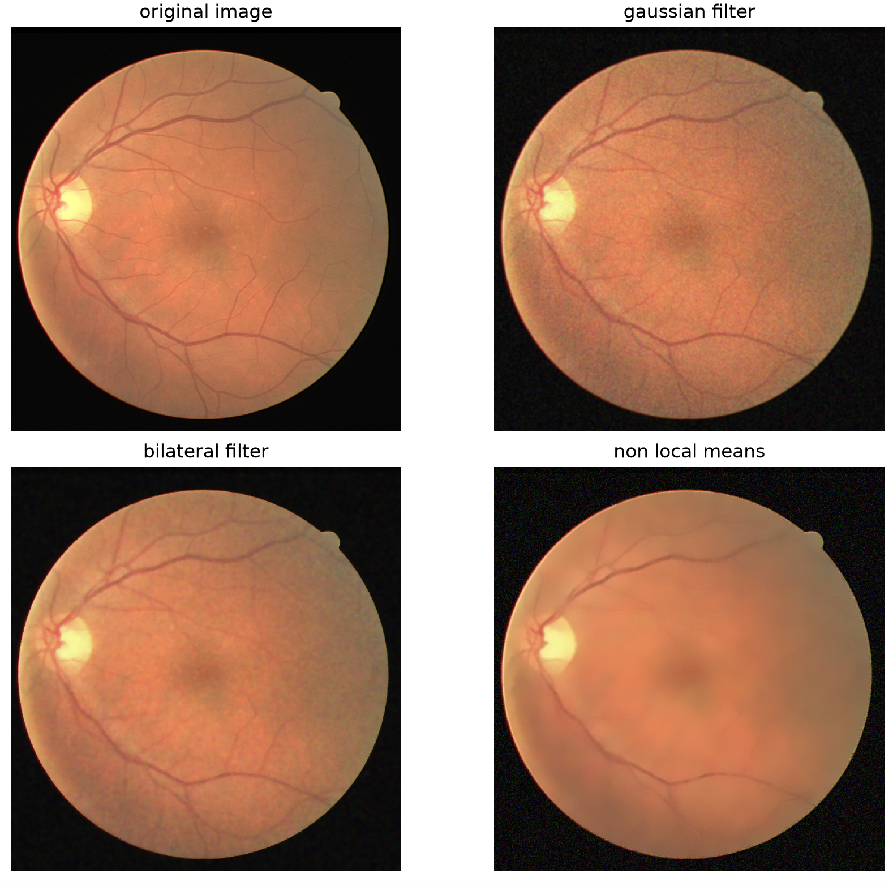

*Filtre clasice.*

## 3.2. Utilizarea informatiilor anatomice si a hartilor de probabilitate

O parte relevanta a cercetarii noastre este utilizarea informatiilor anatomice pentru a imbunatati procesarea imaginilor medicale. Exista metode iterative de reducere a zgomotului in imagini CT [1] care utilizeaza cunostinte anterioare despre imagine. Este sustinuta ideea ca informatiile suplimentare pot contribui la imbunatatirea procesului de denoising.

In cazul imaginilor retiniene, identificarea vaselor sanguine reprezinta o problema importanta, deoarece acestea pot avea dimensiuni reduse si un contrast scazut fata de tesuturile inconjuratoare. Tian impreuna cu alti colaboratori [2] au propus o metoda de segmentare a vaselor retiniene care combina o varianta imbunatatita a filtrului Frangi cu operatii de morfologie matematica. Desi obiectivul principal este segmentarea, lucrarea evidentiaza importanta identificarii structurilor vasculare fine.

O alta abordare este utilizarea atlaselor anatomice probabilistice. A fost studiata construirea atlaselor cerebrale pornind de la imagini etichetate manual [12], utilizandu-se inferenta Bayesiana. Este de remarcat ca este necesara alinierea imaginilor pentru estimarea corecta a distributiei spatiale a structurilor anatomice cerebrale.

Aceasta idee este destul de apropiata de principiul utilizat in cercetarea noastra. Pornind de la mai multe imagini medicale si masti anatomice corespunzatoare, se poate estima frecventa de aparitie a unei structuri in fiecare pozitie a unui sistem de referinta comun. Spre deosebire de o masca binara, o harta de probabilitate permite reprezentarea graduala a prezentei unei structuri anatomice. Regiunile cu probabilitate ridicata pot indica zone in care este necesara o atentie sporita pentru conservarea detaliilor.

Totusi, exista o diferenta importanta inre utilizarea atlaselor pentru segmentare si utilizarea lor pentru reducerea zgomotului. In cercetarea noastra, harta probabilistica este folosita pentru a controla intensitatea filtrarii aplicate in acea regiune.

## 3.3. Comparatia cu abordarea propusa si limitarile metodelor existente

Metodele prezentate in literatura urmaresc reducerea zgomotului prin strategii diferite. Filtrele clasice folosesc proprietatile locale ale imaginii, metodele bazate pe NLM exploateaza similaritati intre regiuni, iar metodele bazate pe deep learning incearca sa invete relatia dintre imaginile zgomotoase si cele de calitate superioara. In continuare, insa, conservarea structurilor anatomice fine ramane o provocare, in special atunci cand acestea au un contrast redus sau dimensiuni apropiate de nivelul detaliilor afectate de zgomot.

Lucrarea lui Liu si a altor colaboratori [9] este relevanta in comparatia cu abordarea noastra, deoarece urmareste explicit restaurarea structurilor subtiri. Diferenta principala consta in mecanismele utilizate: autorii folosesc o retea neuronala si un mecanism de filtrare locala in timpul antrenarii, in timp ce metoda noastra utilizeaza o harta statistica a structurilor anatomice pentru a controla direct intensitatea filtrarii, fara antrenarea unei retele neuronale. Cercetarea noastra exploreaza o forma specifica de informatie anterioara: probabilitatea spatiala de aparitie a structurilor anatomice fine.

Comparatia conceptuala dintre metode este prezentata in tabelul urmator:

| Metoda | Principiul utilizat                                    | Diferenta fata de abordarea propusa |
| --- |--------------------------------------------------------| --- |
| Filtrare bilaterala adaptata [6] | Filtrare orientata in functie de caracteristicile locale | Nu utilizeaza o harta statistica obtinuta din adnotari anatomice multiple|
| NLM cu procesare morfologica [13] | Similaritate non-locala si prelucrarea reziduurilor    | Nu controleaza filtrarea prin probabilitati anatomice spatiale|
| Gaussian-Wiener adaptiv [5] | Adaptarea filtrarii la caracteristicile zgomotului     | Adaptarea nu este ghidata de frecventa aparitiei structurilor anatomice|
| Prior knowledge aware denoising [1] | Utilizarea cunostintelor anterioare in filtrarea iterativa| Utilizeaza o alta forma de informatie anterioara|
| Improved DD-Net [9] | Reteaua neuronala si mecanism de filtrare locala| Necesita antrenare; metoda noastra foloseste filtrare ghidata de o harta statistica|
| Atlase probabilistice [12] | Modelarea distributiei spatiale a structurilor anatomice| Sunt utilizate pentru modelare anatomica, nu direct pentru controlul filtrarii|
| Metoda propusa | Filtrare adaptiva ghidata de probabilitati anatomice| Combina harti statistice cu filtre conventionale, fara retele neuronale|

Abordarea propusa in aceasta cercetare urmareste sa combine avantajele filtrelor conventionale cu informatiile obtinute din adnotarile anatomice. In regiunile in care probabilitatea de aparitie a unei structuri fine este ridicata, filtrarea este redusa pentru a limita estomparea. In celelalte regiuni poate fi aplicata o filtrare mai puternica, care sa elimine zgomotul. Scopul principal este obtinerea unei conservari mai bune a structurilor anatomice fine, fara deteriorarea semnificative a calitatii globale a imaginii. Aceasta reprezinta ipoteza care sta la baza experimentelor prezentate in capitolele urmatoare.

Pentru evaluarea eficientei, sunt utilizate metrici globale (PSNR si SSIM) si metrici specifice structurilor anatomice. In experimentele pe imaginile retiniene sunt analizate separat vasele sanguine subtiri si groase, iar pentru imaginile OCT este evaluata conservarea regiunilor corespunzatoare straturilor retiniene. Comparatiile cu filtrarea Gaussiana, bilaterala si NLM permit evaluarea comportamentului metodei in raport cu abordari clasice. 

# 4. Metoda propusa (modelarea partii experimentale)

Metoda propusa in aceasta cercetare urmareste reducerea zgomotului din imaginile medicale, acordans o atentie speciala conservarii structurilor anatomice fine. Abordarea porneste de la observatia ca aplicarea uniforma a unui filtru asupra intregii imagini poate elimina zgomotul, dar poate afecta si detalii importante, precum vase de sange subtiri sau limitele dintre straturile retiniene.

Pentru a limita acest efect, propunem utilizarea unor harti statistice de probabilitate, construite din adnotari anatomice disponibile pentru mai multe imagini. Aceste harti sunt folosite pentru adaptarea spatiala a filtrarii, astfel incat regiunile in care este mai probabila prezenta unor structuri fine sa beneficieze de o filtrare mai slaba.

Metoda nu necesita antrenarea unei retele neuronale. Ea combina tehnici conventionale de procesare a imaginilor cu informatii anatomice statistice, obtinand un compromis intre reducerea zgomotului si conservarea detaliilor.

## 4.1. Definirea problemei si ipoteza de cercetare

O imagine medicala afectata de zgomot poate fi descrisa prin urmatorul model: $$I_n(x,y)=I(x,y)+N(x,y)$$, unde:
* $I(x,y)$ reprezinta imaginea originala
* $N(x,y)$ reprezinta zgomotul adaugat
* $I_n(x,y)$ reprezinta imaginea afectata de zgomot

In experimentele realizate este utilizat zgomot Gaussian sintetic, generat controlat. Acest model permite evaluarea metodelor de filtrare in conditii reproductibile, deoarece imaginea originala este cunoscuta si poate fi utilizata drept referinta.

Problema principala este ca reducerea zgomotului presupune de regula eliminarea variatiilor locale ale intensitatii. Totusi, unele dintre aceste variatii corespund unor structuri anatomice reale, nu zgomotului. Prin urmare, o filtrare prea puternica poate produce estomparea sau chiar disparitia unor detalii fine.

Ipoteza cercetarii este ca utilizarea unei harti statistice de probabilitate a structurilor anatomice fine pentru controlul spatial al filtrarii poate imbunatati conservarea acestor structuri, comparativ cu aplicarea uniforma a filtrarii, mentinand in acelasi timp o reducere eficienta a zgomotului. Pentru verificarea acestei ipoteze sunt urmarite 3 obiective:
1. Construirea unor harti statistice de probabilitate din imagini medicale si adnotari anatomice.
2. Utilizarea acestor harti pentru adaptarea intensitatii filtrarii in functie de regiunea analizata.
3. Evaluarea calitatii imaginilor rezultate, atat la nivel global, cat si separat pentru structurile anatomice de interes.

Abordarea este inspirata de utilizarea informatiilor anterioare in procesarea imaginilor medicale [1] si de principiile modelarii probabilistice a structurilor anatomice [12]. Diferenta consta in utilizarea directa a probabilitatilor estimate pentru controlul filtrarii.

## 4.2. Descrierea generala a abordarii propuse

Metoda este organizata in doua etape principale: construirea hartii statistice de probabilitate si utilizarea acesteia pentru reducerea adaptiva a zgomotului.

In prima etapa sunt folosite imagini medicale insotite de adnotari. Imaginile sunt pregatite si aliniate intr-un sistem de referinta comun, pentru ca aceeasi pozitie spatiala sa corespunda unor regiuni anatomice comparabile. Ulterior, mastile anatomice sunt agregate pentru a estima probabilitatea de aparitie a structurii de interes in fiecare pozitie. Rezultatul este o varta cu valori cuprinse intre 0 si 1, unde valorile mai mari indica o frecventa mai ridicata a prezentei structurii respective in datele utilizate.

In a doua etapa, o imagine afectata de zgomot este procesata prin doua variante de filtrare:
- filtrare slaba, care conserva mai bine detaliile, dar elimina o cantitate mai mica de zgomot
- filtrare puternica, care reduce mai mult zgomotul, dar poate duce la pierderea structurilor fine de interes

Rezultatele celor doua filtre sunt combinate in functie de harta probabilistica. In regiunile cu probabilitate ridicata este acordata o pondere mai mare filtrarii slabe, iar in regiunile cu probabilitate redusa este favorizata filtrarea puternica. Fluxul general al metodei este ilustrat in figura de mai jos:

```text[Imagini medicale si adnotari] 
       │
       ▼
[Aliniere si normalizare anatomica]
       │
       ▼
[Construirea hartii de probabilitate] ───┐
                                         │
[Imagine de test]                        │
       │                                 │
       ▼                                 ▼
[Adaugarea zgomotului sintetic] ──► [Combinare adaptiva] ──► [Imagine filtrata]
       │              │                  ▲                          │
       ▼              ▼                  │                          ▼
[Filtrare slaba]  [Filtrare puternica] ──┘               [Evaluarea calitatii si 
                                                          a structurilor fine]
```

Pentru experimentele realizate, filtrarea adaptiva utilizeaza in principal variante de filtrare Gaussiana cu intensitati diferite. Combinarea rezultatelor este realizata la nivel de pixel, pe baza valorilor hartii probabilistice.

Metoda a fost investigata pe doua tipuri de imagini: imagini retiniene de fund de ochi si imagini OCT. Acestea prezinta structuri anatomice diferite si necesita proceduri distincte de aliniere si normalizare. In cazul imaginilor retiniene sunt analizate vasele sanguine, iar in cazul imaginilor OCT sunt analizate structurile asociate straturilor retiniene, cu accent pe regiunea OPL (Outer Plexiform Layer).

Au fost investigate si aspecte legate de extinderea metodei la imagini volumetrice CT. Aceasta directie presupune utilizarea unei harti tridimensionale de probabilitate si adaptarea procedurilor de normalizare spatiala. Totusi, experimentele principale de evaluare a conservarii structurilor fine sunt realizate pe imaginile retiniene si OCT.

## 4.3. Selectarea si pregatirea seturilor de date

Pentru evaluarea metodei propuse au fost selectate seturi de date medicale care contin atat imagini, cat si adnotari anatomice. Existenta acestor adnotari este importanta, deoarece permite construirea hartilor statistice si evaluarea conservarii structurilor de interes.

### Setul de date DRIVE

DRIVE (Digital Retinal Images for Vessel Extraction) [16] contine imagini retiniene de fund de ochi si adnotari ale vaselor sanguine. Setul este utilizat frecvent in cercetari privind segmentarea vasculara, fiind relevant si pentru analiza conservarii vaselor fine.

In cadrul proiectului sunt utilizate cele 20 de imagini de antrenare pentru construirea hartii probabilistice si cele 20 de imagini de test pentru evaluarea metodei. Pregatirea imaginilor presupune identificarea regiunii retiniene valide, utilizarea mastilor vasculare si alinierea imaginilor pe baza pozitiei discului optic. Aceasta aliniere este necesara deoarece pozitia si orientarea structurilor anatomice variaza intre imagini. Pentru analiza structurilor vasculare au fost luate in considerare si adnotarile RITE [18], utilizate in cercetari privind segmentarea si analiza vaselor retiniene.

Pentru construirea hartii statistice sunt utilizate doar regiunile valide ale imaginilor. Astfel, probabilitatea este calculata tinand cont de numarul de observatii disponibile in fiecare pozitie, evitand influenta regiunilor din afara campului vizual. Au fost construite doua variante ale hartii: una directa, obtinuta prin agregarea mastilor, si una netezita, destinata reducerii efectelor variabilitatii anatomice si ale erorilor mici de aliniere.

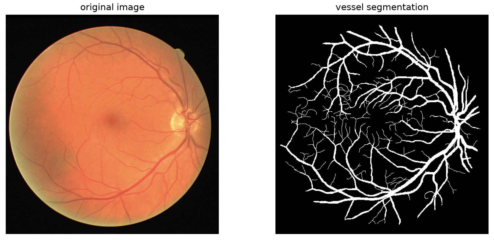

*Sample din setul de date DRIVE.*

### Setul de date OCT

Pentru analiza structurilor stratificate ale retinei este utilizat setul de date OCT 2015_BOE_Chiu [17], care contine imagini OCT si adnotari manuale ale limitelor dintre straturile retiniene. In cadrul experimentelor sunt analizate in special structurile asociate stratului OPL. Pornind de la limitele anatomice adnotate, sunt construite masti care identifica regiunea de interes. 

Spre deosebire de imaginile de fund de ochi, imaginile OCT necesita o normalizare care sa tina cont de forma si curbura straturilor retiniene. In proiect au fost investigate atat aplatizarea imaginilor in raport cu o limita anatomica, cat si normalizarea bazata pe doua limite.

Pentru construirea hartilor probabilistice OCT sunt utilizati subiectii 1-8, iar subiectii 9-10 sunt rezervati evaluarii. Aceasta separare permite testarea metodei pe subiecti care nu au contribuit la construirea hartii. Harta probabilistica obtinuta pentru regiunea OPL este ilustrata in figura 4.3.

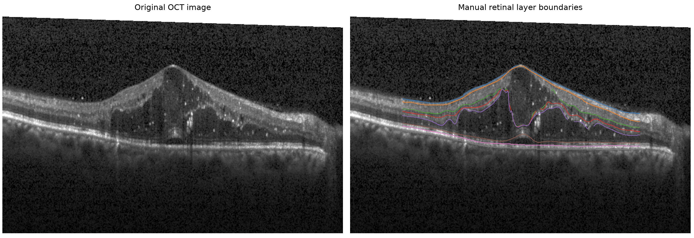

*Sample din setul de date OCT.*

### Date volumetrice CT

Pentru investigarea posibilitatii de extindere a metodei la imagini tridimensionale au fost explorate volume CT si micro-CT din setul Human Bony Labyrinth. Aceste date permit analiza structurilor anatomice in trei dimensiuni si verificarea unor operatii necesare pentru construirea unei harti probabilistice volumetrice. In aceasta etapa, utilizarea volumelor CT are un caracter exploratoriu. Evaluarea cantitativa principala a metodei adaptive ramane concentrata pe seturile DRIVE si OCT.

### Pregatirea datelor pentru experimente

Pentru asigurarea unor comparatii corecte, imaginile sunt prelucrate printr-o serie de operatii comune:
1. Incarcarea imaginilor si a adnotarilor corespunzatoare
2. Identificarea regiunilor valide si a structurilor anatomice de interes
3. Alinierea sau normalizarea imaginilor intr-un sistem de referinta comun
4. Construirea hartilor probabilistice folosind datele de antrenare
5. Normalizarea intensitatilor imaginilor si adaugarea zgomotului sintetic Gaussian
6. Aplicarea metodelor de filtrare si evaluarea rezultatelor pe datele de test

Utilizarea unor imagini originale ca referinta permite calcularea unor indicatori cantitativi ai calitatii, precum PSNR si SSIM. In plus, mastile anatomice permit evaluarea separata a regiunilor de interes, pentru a observa daca reducerea zgomotului afecteaza structurile fine. Procedurile exacte de aliniere, construirea hartilor statistice si modelarea matematica a filtrarii adaptive sunt prezentate in subcapitolele urmatoare.

## 4.4. Alinierea si normalizarea anatomica a imaginilor

Construirea unei harti statistice de probabilitate necesita ca structurile anatomice din imaginile utilizate sa fie reprezentate intr-un sistem de coordonate comparabil. In absenta alinierii, aceeasi structura poate ocupa pozitii diferite de la un subiect la altul, iar agregarea mastilor poate produce o harta neclara sau dificil de interpretat. In cadrul proiectului au fost implementate proceduri diferite pentru imaginile retiniene DRIVE si imaginile OCT, adaptate caracteristicilor anatomice ale acestora.

### Alinierea imaginilor DRIVE

In cazul imaginilor retiniene, alinierea este realizata folosind pozitia discului optic, o structura anatomica relativ usor de identificat datorita luminozitatii sale ridicate. Procedura implementata in src/driveAlignment.py presupune identificarea centrului discului optic si deplasarea imaginii astfel incat acesta sa ajunga intr-o pozitie de referinta comuna. Identificarea automata foloseste canalul rosu al imaginii si o estimare a luminozitatii locale, calculata prin filtrare Gaussiana. Sunt luate in considerare doar regiunile valide din campul vizual, evitand selectarea zonelor apropiate de marginea retinei.

Pentru anumite imagini, implementarea permite si utilizarea unor coordonate corectate manual, salvate in fisierul results/drive_optic_disc_centers.json. Daca discul optic se afla in jumatatea stanga a imaginii, aceasta este reflectata orizontal, astfel incat orientarea sa sa fie comparabila cu a celorlalte imagini. 

Ulterior, se aplica o translatie catre o pozitie de referinta situata la aproximativ 80% din latimea imaginii si la jumatatea inaltimii. Aceeasi transformare este aplicata imaginii originale, mastii vasculare si mastii campului vizual. Pentru imaginile color se foloseste interpolarea biliniara, iar pentru mastile binare interpolarea prin cel mai apropiat vecin, pentru a evita introducerea unor valori intermediare.

Aceasta aliniere nu elimina complet variabilitatea anatomica dintre subiecti, dar reduce diferentele globale de pozitie si orientare, facilitand construirea hartii statistice.

### Normalizarea anatomica a imaginilor OCT

In imaginile OCT, straturile retiniene au o organizare aproximativ orizontala, insa forma si grosimea lor variaza intre subiecti si intre sectiunile aceluiasi volum. Pentru compararea acestora a fost implementata initial o metoda de aplatizare a retinei (flattening), care deplaseaza vertical fiecare coloana astfel incat o limita anatomica de referinta sa ajunga la aceeasi inaltime.

Ulterior, a fost dezvoltata o normalizare bazata pe doua limite anatomice, implementata in src/retinalNormalization.py. Aceasta metoda transforma intervalul dintre o limita superioara si una inferioara intr-un interval vertical standardizat. In implementarea utilizata, limitele de referinta sunt prima si ultima dintre cele opt limite anatomice disponibile, iar pozitiile tinta implicite sunt randurile 100 si 350.

Intensitatile sunt obtinute prin interpolare biliniara, iar mastile anatomice sunt transformate utilizand aceleasi coordonate, cu interpolare prin cel mai apropiat vecin. Normalizarea bazata pe doua limite reduce atat diferentele de pozitie, cat si o parte dintre diferentele de grosime ale retinei. Astfel, regiunea OPL poate fi comparata mai usor intre imagini.

Totusi, transformarea nu garanteaza suprapunerea perfecta a tuturor straturilor intermediare, iar aceasta limitare trebuie luata in considerare la interpretarea hartilor probabilistice.

## 4.5. Construirea hartilor statistice de probabilitate

Dupa alinierea sau normalizarea imaginilor, mastile anatomice sunt utilizate pentru estimarea probabilitatii de aparitie a structurilor fine in fiecare pozitie spatiala. Principiul este asemanator celui utilizat in construirea atlaselor anatomice probabilistice [12], insa in aceasta cercetare rezultatul este folosit pentru ghidarea reducerii zgomotului.

Considerăm un set de $N$ imagini, fiecare având o mască anatomică binară $M_i(x,y)$, definită prin:

$$M_i(x,y) = \begin{cases} 1, & \text{dacă structura este prezentă} \\  0, & \text{în caz contrar} \end{cases}$$

Deoarece nu toate pozițiile sunt valide în fiecare imagine, introducem și o mască de validitate $V_i(x,y)$.
Harta probabilistică este calculată prin:
$$P(x,y) = \frac{\sum_{i=1}^{N} M_i(x,y)V_i(x,y)}{\sum_{i=1}^{N} V_i(x,y)}$$
pentru pozițiile în care numitorul este diferit de zero.

Valorile hartii apartin intervalului ([0,1]). O valoare apropiata de 1 indica faptul ca structura a fost prezenta frecvent in pozitia respectiva, in timp ce o valoare apropiata de 0 indica o frecventa redusa. Aceasta probabilitate reprezinta o estimare statistica obtinuta din datele de antrenare, nu certitudinea ca structura exista intr-o imagine noua.

### Harta probabilistica pentru vasele sanguine DRIVE

Pentru imaginile DRIVE au fost construite doua variante ale hartii probabilistice.
Prima varianta, denumita Direct Probability Map, este obtinuta prin agregarea mastilor vasculare aliniate, folosind formula prezentata anterior.

A doua varianta, Smoothed Probability Map, aplica o netezire Gaussiana atat sumei mastilor vasculare, cat si numarului de observatii valide.
Netezirea are rolul de a reduce sensibilitatea hartii la diferentele mici de pozitie dintre vasele sanguine ale subiectilor. De asemenea, permite extinderea graduala a probabilitatii in jurul regiunilor unde vasele apar frecvent.

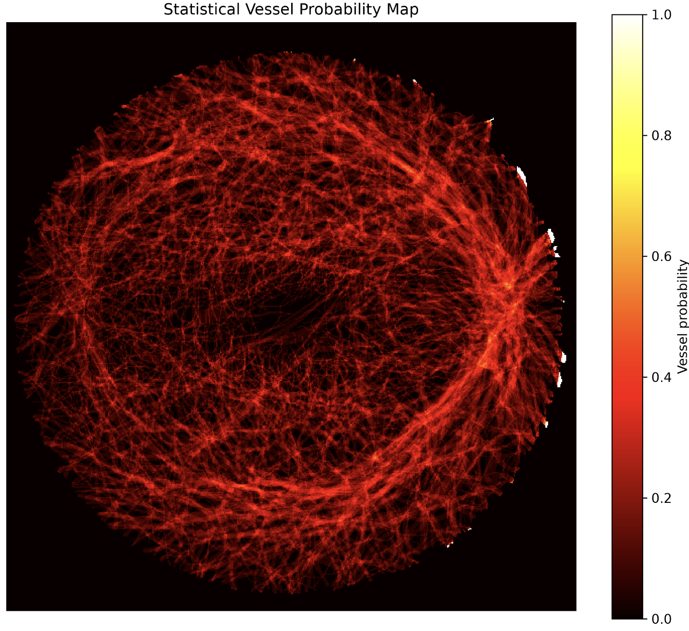

*Harta probabilistica rezultata pentru DRIVE.*

### Harta probabilistica pentru regiunea OPL

Pentru imaginile OCT, harta probabilistica este construita din mastile corespunzatoare regiunii OPL, obtinute pe baza limitelor anatomice adnotate. Dupa normalizarea imaginilor, mastile sunt agregate in acelasi sistem de coordonate. Pentru fiecare pozitie este inregistrat atat numarul de aparitii ale structurii, cat si numarul de observatii valide.

In proiect au fost investigate mai multe variante de construire a hartii, inclusiv aplatizarea retinei si normalizarea bazata pe doua limite anatomice.
In evaluarea variantei V2, pozitiile sunt considerate suficient sustinute statistic daca exista cel putin cinci observatii valide. Regiunile fara suport suficient nu sunt tratate ca estimari anatomice de incredere.
Pentru experimentele finale OCT V4 a fost construita o harta separata, salvata in results/opl_probability_map_v4_train.npy, astfel incat evaluarea sa fie realizata pe subiecti diferiti de cei folositi la construirea hartii.

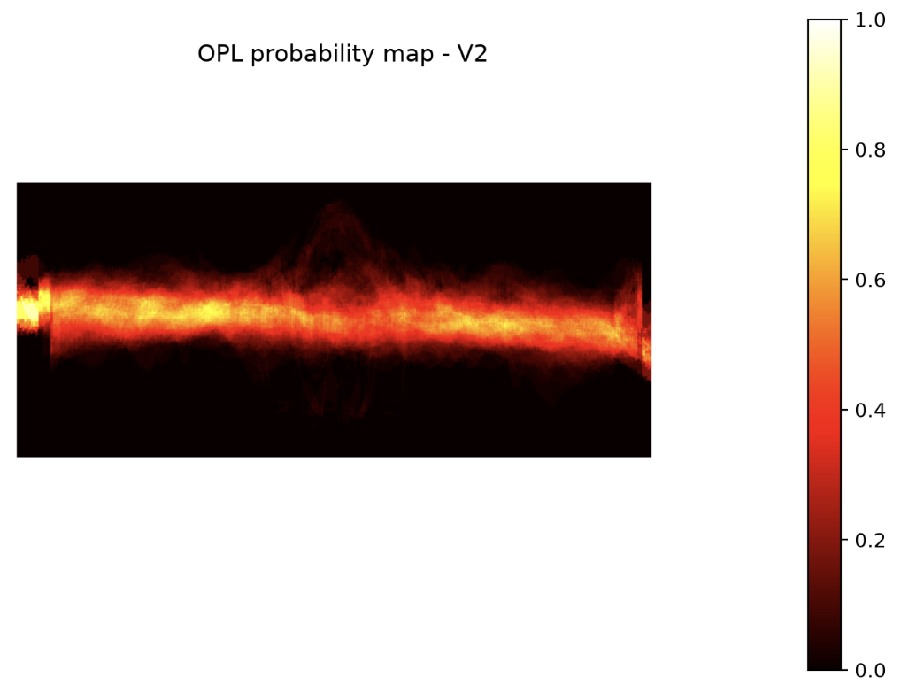

*Harta probabilistica rezultata pentru OCT.*

## 4.6. Modelarea matematica a filtrarii adaptive

Metoda de filtrare propusa combina rezultatele a doua filtre Gaussiene cu intensitati diferite, utilizand harta probabilistica pentru stabilirea ponderii fiecaruia.

Consideram imaginea afectata de zgomot $I_n$, pentru care sunt calculate doua rezultate:
$$I_w = G_{\sigma_w} * I_n$$
$$I_s = G_{\sigma_s} * I_n$$
unde $I_w$ reprezinta imaginea filtrata slab, iar $I_s$ imaginea filtrata puternic.

Combinarea adaptiva este definita prin:
$$I_a(x,y) = w(x,y)I_w(x,y) + (1 - w(x,y))I_s(x,y)$$
unde $w(x,y) \in [0,1]$ reprezinta ponderea filtrarii slabe.

Astfel, pentru $w=1$, rezultatul corespunde filtrarii slabe, iar pentru $w=0$, rezultatul corespunde filtrarii puternice.

### Filtrarea adaptiva pentru imaginile DRIVE

In varianta de baza, ponderea este egala cu probabilitatea anatomica:
$$w(x,y) = P(x,y)$$

Pentru a controla intensitatea protectiei, a fost introdus un parametru suplimentar $\alpha$:
$$w(x,y) = \min(1, \max(0, \alpha P_s(x,y)))$$
unde $P_s$ reprezinta harta probabilistica netezita.

Parametrul $\alpha$ este selectat prin evaluarea mai multor valori pe imaginile de antrenare, utilizand o procedura de tip *leave-one-out*. Criteriul de selectie este valoarea medie PSNR calculata in regiunile vasculare.
In evaluarea DRIVE, implementarea foloseste $\alpha = 0.5$, iar zgomotul Gaussian sintetic are abaterea standard $\sigma_n = 0.08$, pentru imagini normalizate in intervalul [0,1].
Prin aceasta formulare, protectia structurilor fine depinde de probabilitatea lor spatiala, dar poate fi ajustata pentru a evita o reducere insuficienta a zgomotului.

### Filtrarea adaptiva pentru imaginile OCT

Pentru imaginile OCT a fost investigata initial combinarea directa a filtrelor in functie de harta probabilistica, denumita V2.

Ulterior, in varianta V4 a fost introdus un mecanism care tine cont si de nivelul zgomotului:
$$w(x,y) = P(x,y)e^{-k\sigma_n}$$
unde:
* $P(x,y)$ reprezinta probabilitatea anatomica;
* $\sigma_n$ reprezinta nivelul zgomotului;
* $k$ reprezinta parametrul care controleaza sensibilitatea la zgomot.

Factorul exponential reduce ponderea filtrarii slabe pe masura ce nivelul zgomotului creste. Astfel, metoda poate acorda o importanta mai mare eliminarii zgomotului atunci cand imaginea este puternic afectata.
Valorile parametrilor au fost investigate in etapa de validare, anterior evaluarii finale pe subiectii de test.

In cazul imaginilor OCT, filtrarea este aplicata tinand cont si de masca regiunii anatomice valide, pentru a evita influenta pixelilor artificiali introdusi prin normalizare.

### Interpretarea efectului filtrarii adaptive

Pentru a intelege influenta hartii probabilistice asupra rezultatului, este utila compararea imaginii originale, a imaginii zgomotoase si a rezultatelor obtinute prin filtrare uniforma si adaptiva. Reprezentarea permite observarea diferentelor vizuale dintre metode.
Principalul avantaj urmarit este obtinerea unui compromis mai bun intre eliminarea zgomotului si pastrarea detaliilor anatomice.

Totusi, o harta probabilistica poate oferi protectie insuficienta structurilor care apar rar sau care prezinta o variabilitate anatomica ridicata. Din acest motiv, eficienta metodei trebuie evaluata experimental, prin comparatii cu filtre uniforme si variante de control.
Rezultatele cantitative, inclusiv PSNR, SSIM si metricile calculate separat pentru structurile anatomice fine, sunt prezentate in capitolul 5.

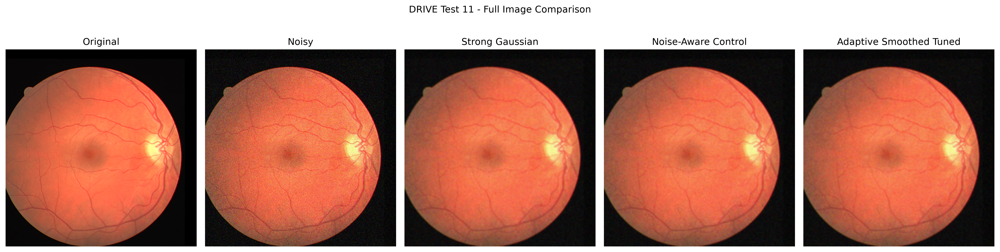

*Comparatie vizuala DRIVE.*

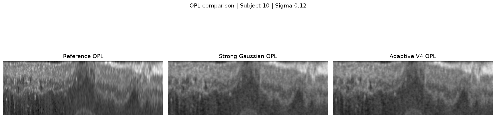

*Comparatie vizuala OCT.*

# 5. Implementare si studiu de caz

Pentru verificarea ipotezei de cercetare a fost dezvoltata o implementare experimentala in Python, care permite construirea hartilor statistice de probabilitate, aplicarea filtrarii adaptive si evaluarea rezultatelor obtinute.

Experimentele au fost organizate astfel incat metoda propusa sa poata fi comparata cu metode conventionale de reducere a zgomotului, in conditii controlate. Au fost utilizate atat imagini retiniene DRIVE, cat si imagini OCT, pentru a investiga comportamentul abordarii pe structuri anatomice diferite.

Evaluarea urmareste doua aspecte: calitatea globala a imaginilor filtrate si conservarea structurilor anatomice de interes. Pentru aceasta sunt utilizate metrici cantitative, comparatii vizuale si analize statistice ale diferentelor dintre metode.

## 5.1. Tehnologii utilizate si organizarea implementarii

Implementarea a fost realizata in limbajul Python, ales datorita bibliotecilor disponibile pentru procesarea imaginilor, calcule numerice si analiza rezultatelor experimentale.

Principalele biblioteci utilizate sunt:

| Biblioteca	                                                 | Rol in proiect                                                                 |
|-------------------------------------------------------------|--------------------------------------------------------------------------------|
| NumPy	                                                      | Operatii cu matrici, masti anatomice si harti probabilistice                   |
| OpenCV                                                      | 	Filtrare Gaussiana, transformari geometrice si procesarea imaginilor          |
| SciPy                                                       | 	Prelucrarea datelor numerice si incarcarea adnotarilor OCT din fisiere MATLAB |
| scikit-image                                                | 	Calculul metricilor de calitate si operatii de procesare a imaginilor         |
| SimpleITK                                                   | 	Explorarea si prelucrarea imaginilor medicale volumetrice                     |
| pandas	                                                     | Centralizarea si analiza rezultatelor experimentale                            |
| Matplotlib | 	Generarea graficelor si a comparatiilor vizuale                               |

Python a fost preferat unor alternative precum C++ sau MATLAB deoarece permite implementarea rapida a experimentelor si integrarea bibliotecilor necesare intr-un singur mediu de lucru. C++ poate oferi avantaje de performanta, dar ar necesita mai mult efort pentru dezvoltarea si modificarea experimentelor, in timp ce MATLAB presupune utilizarea unui mediu software specializat.

Codul este organizat modular, separand operatiile de procesare a imaginilor de procedurile experimentale si de analiza a rezultatelor. Structura generala a proiectului este urmatoarea:
- MedicalImageDenoising
    - data
    - src
    - experiments
    - results
    - main.py
    - readme.md 
    - researchProj.md

Directorul src/ contine functiile reutilizabile pentru alinierea imaginilor, normalizarea anatomica si filtrarea adaptiva.
Directorul experiments/ contine procedurile de evaluare, configurarea experimentelor si generarea rezultatelor. De exemplu, evaluateDriveAdaptive.py realizeaza comparatiile pe imaginile DRIVE, iar evaluateAdaptiveV4Final.py evalueaza varianta finala a metodei pentru imaginile OCT.
Rezultatele sunt salvate in directorul results/, sub forma de fisiere CSV pentru metricile numerice, fisiere NumPy pentru hartile probabilistice si imagini PNG pentru reprezentarile vizuale.

Aceasta organizare permite repetarea experimentelor, modificarea parametrilor si compararea variantelor metodei fara schimbarea componentelor de baza.

## 5.2. Configurarea experimentelor si a seturilor de testare

Experimentele au fost realizate pe doua tipuri de imagini medicale: DRIVE, pentru analiza vaselor sanguine retiniene, si OCT, pentru analiza structurilor stratificate ale retinei.
Pentru fiecare experiment, imaginile sunt pregatite si normalizate, dupa care este adaugat zgomot Gaussian sintetic. Metodele de filtrare sunt aplicate asupra aceleiasi imagini zgomotoase, iar rezultatele sunt comparate cu imaginea originala.

### Configurarea experimentelor DRIVE

Pentru DRIVE, cele 20 de imagini de antrenare au fost utilizate pentru construirea hartilor probabilistice si selectarea parametrilor, iar cele 20 de imagini de test pentru evaluarea finala.

Sunt comparate urmatoarele variante:
* Weak Gaussian – filtrare Gaussiana slaba, cu nucleu 3 x 3 si (sigma=0.6).
* Strong Gaussian – filtrare Gaussiana puternica, cu nucleu 7 x 7 si (sigma=1.8).
* Adaptive Direct – filtrare adaptiva folosind harta probabilistica directa.
* Adaptive Smoothed – filtrare adaptiva folosind harta probabilistica netezita.
* Adaptive Smoothed Tuned – varianta netezita, cu parametrul de protectie (alpha=0.5).
* Noise-Aware Control – combinare a celor doua filtre folosind o pondere constanta, fara adaptare spatiala.

Parametrul $\alpha$ a fost selectat pe datele de antrenare, prin procedura leave-one-out descrisa in sectiunea 4.6, fara utilizarea imaginilor de test.

### Configurarea experimentelor OCT

Pentru OCT, harta probabilistica finala a fost construita folosind subiectii 1–8, iar evaluarea a fost realizata pe subiectii 9 si 10, dupa normalizarea anatomica descrisa in sectiunea 4.4.

In experimentele finale sunt comparate:
* Weak Gaussian – filtrare slaba.
* Strong Gaussian – filtrare puternica.
* Adaptive V2 – combinare adaptiva pe baza hartii probabilistice.
* Adaptive V4 – filtrare adaptiva care tine cont si de nivelul zgomotului.
* Noise-Aware Control – combinare cu pondere constanta, ajustata in functie de nivelul zgomotului.

Parametrul $k$ al variantei V4 este configurat in functie de nivelul zgomotului. Valorile utilizate in evaluarea finala sunt prezentate in tabelul urmator:

| Nivel zgomot | 	Parametrul (k) |
|--------------|-----------------|
| 0.04         | 	0              |
|0.08	|15|
|0.12	|20|

In total, evaluarea finala cuprinde 22 de sectiuni OCT valide pentru fiecare nivel de zgomot, provenite de la cei doi subiecti de test.

### Sinteza configuratiei experimentale

| Caracteristica                                           | 	DRIVE                   | 	OCT                           |
|----------------------------------------------------------|--------------------------|--------------------------------|
| Structuri analizate                                      | 	Vase sanguine           | 	Regiunea OPL                  |
| Date de test	                                            | 20 imagini	              | 22 sectiuni valide, 2 subiecti |
| Aliniere                                                 | 	Pozitia discului optic	 | Normalizare pe doua limite     |
| Niveluri de zgomot	                                      | 0.08	                    | 0.04, 0.08, 0.12               |
| Metoda adaptiva finala                                   | 	Adaptive Smoothed Tuned | 	Adaptive V4                   |
| Parametru adaptiv	                                       | (alpha=0.5)	             | (k=0,15,20)              |
| Evaluare structurala	| Vase subtiri si groase	  | Regiunea OPL             |

Fluxul de evaluare este prezentat in schema urmatoare:

```text
[Date de antrenare si adnotari]
       │
       ▼
[Aliniere si normalizare]
       │
       ▼
[Harta probabilistica] ────────────────┐
                                       │
[Date de test separate]                │
       │                               │
       ▼                               ▼
[Adaugarea zgomotului] ────────► [Filtrare adaptiva] ──► [Evaluare fata de imaginea originala]
       │              │                  ▲                          │
       ▼              ▼                  │                          ▼
[Filtre de referinta] ───────────────────┘               [Metrici globale si anatomice]
                                                                    │
                                                                    ▼
                                                         [Analiza comparativa si statistica]
```

Prin aplicarea tuturor metodelor asupra acelorasi imagini zgomotoase, diferentele obtinute pot fi atribuite mai usor strategiilor de filtrare, fara influenta unor conditii de testare diferite.

## 5.3. Metrici de evaluare a calitatii si conservarii structurilor

Pentru evaluarea rezultatelor sunt utilizate metrici globale ale calitatii imaginii, precum si metrici calculate exclusiv in regiunile anatomice de interes.
Aceasta distinctie este importanta deoarece o metoda poate obtine o calitate globala buna, dar poate estompa structuri anatomice fine, care ocupa doar o parte redusa din imagine.

### Peak Signal to Noise Ratio (PSNR)

PSNR masoara diferenta dintre imaginea de referinta si imaginea filtrata, fiind exprimat in decibeli (dB).
Pentru o imagine cu intensitati normalizate in intervalul $[0,1]$, metrica este definita prin:

$$\text{PSNR} = 10 \log_{10} \left( \frac{1}{\text{MSE}} \right)$$
unde $\text{MSE}$ reprezinta eroarea medie patratica:
$$\text{MSE} = \frac{1}{N} \sum_{i=1}^{N} (I_i - \hat{I}_i)^2$$
unde:
* **$I_i$** — intensitatea pixelului din imaginea de referinta;
* **$\hat{I}_i$** — intensitatea corespunzatoare din imaginea filtrata;
* **$N$** — numarul total de pixeli din regiunea evaluata.

O valoare PSNR mai mare indica o diferenta medie patratica mai mica fata de imaginea originala.
In experimente sunt calculate atat valori PSNR globale, cat si valori limitate la regiunile anatomice de interes.

PSNR a fost folosit de asemenea in evaluarea separata a conservarii structurilor fine, folosindu-se doar pixeli care apartin unei masti anatomice. Aceasta evaluare permite identificarea diferentelor care ar putea fi mascate de rezultatele globale.
Pentru DRIVE sunt analizate separat vasele sanguine si fundalul imaginii. In plus, vasele sunt clasificate in vase subtiri si groase pe baza grosimii locale estimate, iar metricile sunt calculate pe pixelii corespunzatori liniilor centrale ale acestor vase.
Pentru OCT este calculat PSNR in regiunea OPL, utilizand mastile obtinute din adnotarile anatomice. 

### Structural Similarity Index (SSIM)

SSIM evalueaza similaritatea structurala dintre doua imagini, tinand cont de luminozitate, contrast si structura locala.
Formula generala este definita prin:

$$\text{SSIM}(x,y) = \frac{(2\mu_x\mu_y + C_1)(2\sigma_{xy} + C_2)}{(\mu_x^2 + \mu_y^2 + C_1)(\sigma_x^2 + \sigma_y^2 + C_2)}$$
unde:
* **$\mu_x, \mu_y$** — mediile locale ale imaginilor;
* **$\sigma_x^2, \sigma_y^2$** — variantele locale;
* **$\sigma_{xy}$** — covarianta dintre cele doua imagini;
* **$C_1, C_2$** — constante utilizate pentru a stabiliza diviziunea cu un numitor apropiat de zero.

Valorile apropiate de $1$ indica o similaritate structurala ridicata.
SSIM a fost utilizat in etapa initiala de comparare a filtrelor conventionale. Pentru evaluarea finala a metodei adaptive, accentul este pus pe PSNR si pe metricile specifice structurilor anatomice.

### Mean Absolute Error (MAE)

MAE masoara diferenta absoluta medie dintre intensitatile imaginii originale si cele ale imaginii filtrate:

$$\text{MAE} = \frac{1}{N} \sum_{i=1}^{N} \vert{}I_i - \hat{I}_i\vert{}$$
unde:
* **$I_i$** — intensitatea pixelului din imaginea originala;
* **$\hat{I}_i$** — intensitatea corespunzatoare din imaginea filtrata;
* **$N$** — numarul total de pixeli din regiunea evaluata.
In experimentele OCT, aceasta metrica este calculata in regiunea OPL si permite evaluarea erorii medii de intensitate in zona anatomica analizata.
Spre deosebire de PSNR, pentru MAE o valoare mai mica indica un rezultat mai bun.

### Eroarea de gradient

Pentru evaluarea conservarii contururilor este utilizata eroarea de gradient, calculata prin compararea variatiilor spatiale ale intensitatii din imaginea de referinta si imaginea filtrata.

Eroarea de gradient este calculata prin:

$$E_{\nabla} = \frac{1}{\vert{}M\vert{}} \sum_{i \in M} \left\vert{} \nabla I_i - \nabla \hat{I}_i \right\vert{}_2$$
unde:
* **$\nabla I_i$** — gradientul din imaginea de referinta;
* **$\nabla \hat{I}_i$** — gradientul corespunzator din imaginea filtrata;
* **$M$** — regiunea de interes (iar $\vert{}M\vert{}$ reprezinta cardinalul/numarul de elemente al acesteia).

In implementare, gradientii sunt estimati folosind operatorul Sobel.
O valoare mai mica indica o diferenta mai redusa intre contururile imaginii originale si cele ale imaginii filtrate.
Aceasta metrica este relevanta pentru cercetarea noastra deoarece structurile anatomice fine pot fi afectate de filtrare chiar si atunci cand diferentele globale de intensitate sunt reduse.

## 5.4. Experimente pe imagini retiniene DRIVE

Primul studiu de caz urmareste evaluarea metodei adaptive pe imagini retiniene, cu accent pe conservarea vaselor sanguine. Aceste structuri reprezinta un exemplu relevant pentru cercetare, deoarece vasele subtiri pot avea un contrast redus si pot fi afectate de aplicarea unei filtrari prea puternice.
Experimentele au fost realizate pe cele 20 de imagini din setul de test DRIVE, folosind hartile probabilistice construite din imaginile de antrenare. Pentru fiecare imagine a fost adaugat zgomot Gaussian sintetic, cu abaterea standard (sigma_n=0.08), iar metodele de filtrare au fost evaluate in aceleasi conditii.
Au fost comparate filtrele Gaussiene slabe si puternice, variantele adaptive bazate pe harti directe si netezite, varianta cu parametrul (alpha=0.5) si o metoda de control care utilizeaza o pondere constanta.

### 5.4.1. Evaluarea calitatii globale si a regiunilor vasculare

Rezultatele medii obtinute pe cele 20 de imagini sunt prezentate in tabelul urmator.

| Metoda	                  | PSNR global (dB)    | 	PSNR vase (dB)	 | Eroare gradient vascular |
|--------------------------|---------------------|-----------------|--------------------------|
| Weak Gaussian	           | 27.929	             | 27.922	            |0.21751           |
| Strong Gaussian          | 	32.946	            | 32.631          | 	0.12346                 |
| Adaptive Direct	         | 32.779	| 32.533	         | 0.12279                  |
| Adaptive Smoothed        | 	32.858| 	32.635         | 	0.12143                 |
| Noise-Aware Control      | 	32.923	| 32.684| 	0.12132                 |
| Adaptive Smoothed Tuned	 | 32.957	| 32.724	| 0.12100                  |

Rezultatele indica faptul ca filtrarea Gaussiana slaba nu elimina suficient zgomotul, obtinand valori PSNR semnificativ mai mici decat celelalte metode. Filtrarea Gaussiana puternica imbunatateste considerabil calitatea globala, insa poate afecta contururile vasculare.
Varianta Adaptive Smoothed Tuned obtine cel mai mare PSNR global si cel mai mare PSNR vascular dintre metodele evaluate. In comparatie cu Strong Gaussian, imbunatatirea medie a PSNR vascular este de aproximativ 0.093 dB, iar fata de Noise-Aware Control este de aproximativ 0.040 dB.

Desi diferentele numerice sunt relativ mici, acestea sunt relevante pentru obiectivul cercetarii, deoarece sunt calculate in regiunile anatomice care trebuie protejate.
In plus, varianta propusa obtine cea mai mica eroare medie de gradient vascular, sugerand o conservare mai buna a variatiilor locale de intensitate asociate structurilor vasculare.

### 5.4.2. Evaluarea conservarii vaselor subtiri si groase

Pentru o analiza mai detaliata, vasele sanguine au fost impartite in doua categorii, in functie de grosimea lor locala. Evaluarea este realizata pe liniile centrale ale vaselor, pentru a analiza separat comportamentul filtrarii asupra structurilor de dimensiuni diferite.
Rezultatele sunt prezentate in tabelul urmator.

| Metoda	| PSNR vase subtiri (dB) | 	PSNR vase groase (dB) |
|---------------------------------------|--------------------------------------------|------------------------|
 | Strong Gaussian	| 32.655                                     | 	32.430                |
|  Noise-Aware Control| 	32.709	                                   | 32.545                 |
 | Adaptive Smoothed	| 32.754                                     | 	32.471                |
| Adaptive Smoothed Tuned	| 32.760                                     | 	32.566           |

Pentru vasele subtiri, metoda propusa obtine o imbunatatire medie de 0.105 dB fata de Strong Gaussian si de 0.051 dB fata de Noise-Aware Control.
Pentru vasele groase, imbunatatirile medii sunt de 0.136 dB si, respectiv, 0.021 dB.

Aceste rezultate arata ca utilizarea hartii probabilistice poate contribui la conservarea structurilor vasculare de dimensiuni diferite. Totusi, beneficiul nu este uniform, iar diferentele fata de metoda de control sunt mai reduse pentru vasele groase.

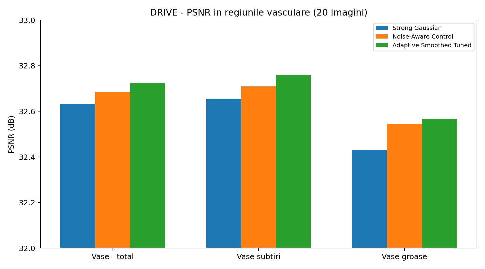

*Tabela de mai sus in format grafic.*

### 5.4.3. Comparatii vizuale

Evaluarea numerica este completata prin comparatii vizuale intre imaginile originale, imaginile afectate de zgomot si rezultatele filtrarii. Pentru exemplificare a fost selectata imaginea 11 din setul DRIVE.


*Comparatia generala intre metodele de filtrare.*

Prima reprezentare permite observarea efectului general al filtrarii asupra imaginii retiniene si compararea vizuala a rezultatelor obtinute prin metodele evaluate.
Pentru examinarea mai detaliata a structurilor anatomice fine, este utilizata o reprezentare a regiunilor vasculare.

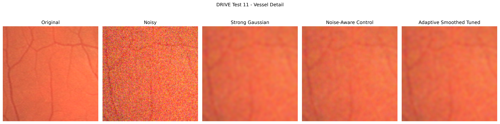

*Detaliile vaselor sanguine si diferentele locale.*

Aceasta reprezentare permite observarea diferentelor locale dintre metode, in special in regiunile in care vasele sanguine sunt subtiri si pot fi afectate de estompare.
In completare, au fost generate harti ale erorilor absolute fata de imaginea de referinta.

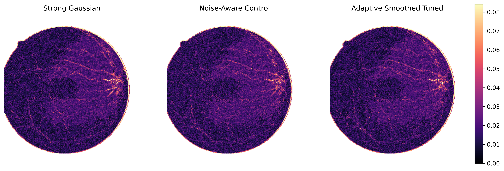

*Erorile absolute fata de imaginea originala.*

Hartile erorilor evidentiaza regiunile in care rezultatele filtrarii difera de imaginea originala. Acestea sunt utile deoarece unele diferente pot fi dificil de observat direct in imaginile filtrate.
Rezultatele experimentale indica un avantaj al variantei adaptive pentru metricile vasculare analizate. Consistenta acestor imbunatatiri intre imaginile de test este examinata in subcapitolul 5.6.

## 5.5. Experimente pe imagini OCT

Al doilea studiu de caz urmareste evaluarea metodei adaptive pe imagini OCT, cu accent pe conservarea regiunii OPL.
Spre deosebire de imaginile DRIVE, imaginile OCT contin structuri anatomice organizate in straturi, iar pozitia acestora variaza intre subiecti. Din acest motiv, inainte de construirea hartii probabilistice a fost aplicata normalizarea anatomica bazata pe doua limite.

Evaluarea finala a fost realizata pe 22 de sectiuni valide provenite de la subiectii 9 si 10, folosind trei niveluri de zgomot Gaussian: 0.04, 0.08, 0.12. Au fost comparate metodele Weak Gaussian, Strong Gaussian, Adaptive V2, Adaptive V4 si Noise-Aware Control.

### 5.5.1. Evaluarea calitatii in regiunea OPL

Rezultatele medii PSNR pentru regiunea OPL sunt prezentate in tabelul urmator.

| Metoda	                              | (sigma_n=0.04)	       | (sigma_n=0.08) | 	(sigma_n=0.12) |
|--------------------------------------|-----------------------|----------------|-----------------|
|  Weak Gaussian| 	33.412	              | 27.809         | 	24.406         |
| Strong Gaussian	| 32.243                | 	31.238        | 	29.975         |
| Adaptive V2	| 33.585| 	30.774	       | 28.300         |
| Adaptive V4| 	33.585	| 31.427	        | 29.982          |
| Noise-Aware Control| 	32.760	| 31.324         | 	29.983        |

La nivelul redus de zgomot, Adaptive V4 obtine un PSNR OPL de 33.585 dB, depasind Strong Gaussian cu aproximativ 1.341 dB si Noise-Aware Control cu aproximativ 0.825 dB.
La nivelul intermediar, Adaptive V4 obtine 31.427 dB, comparativ cu 31.324 dB pentru metoda de control. Imbunatatirea este de aproximativ 0.102 dB.
La nivelul ridicat de zgomot, Adaptive V4 si Noise-Aware Control obtin rezultate practic identice, diferenta medie fiind apropiata de zero.

Aceasta evolutie indica faptul ca avantajul adaptarii spatiale este mai evident atunci cand nivelul zgomotului permite conservarea unor detalii anatomice. La zgomot ridicat, necesitatea unei filtrari mai puternice reduce contributia hartii probabilistice.

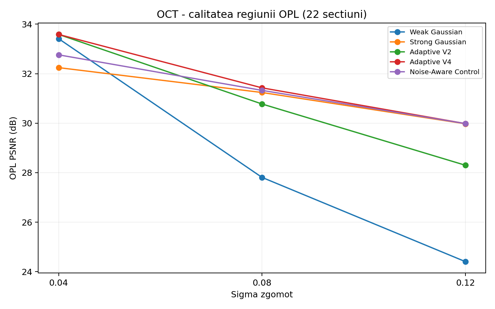

*Tabela de mai sus in format grafic.*

### 5.5.2. Evaluarea calitatii globale

Pentru a verifica daca protectia regiunii OPL afecteaza calitatea generala a imaginii, a fost calculat si PSNR global.

|Metoda|	(sigma_n=0.04)	|(sigma_n=0.08)	|(sigma_n=0.12)|
|------|--------------------|---------------|--------------|
|Weak Gaussian	|33.165	|27.735	|24.411|
|Strong Gaussian|	31.008|	30.249	|29.235|
|Adaptive V2	|31.251	|30.183	|28.868|
|Adaptive V4	|31.251	|30.290|	29.238|
|Noise-Aware Control	|31.553|	30.355	|29.251|

Rezultatele arata ca metoda cu cel mai bun PSNR in regiunea OPL nu este neaparat si metoda cu cel mai bun PSNR global.
La zgomot redus, Weak Gaussian obtine cea mai buna valoare globala, deoarece filtrarea puternica modifica inutil unele regiuni ale imaginii.
Adaptive V4 favorizeaza conservarea regiunii OPL, dar obtine un PSNR global mai mic decat Weak Gaussian. Aceasta diferenta reflecta compromisul dintre obiectivul de protectie anatomica si optimizarea calitatii globale.
La nivelurile mai ridicate de zgomot, rezultatele globale ale variantei Adaptive V4 sunt apropiate de cele ale filtrarii Gaussiene puternice si ale metodei de control.

### 5.5.3. Evaluarea conservarii contururilor OPL

Pentru evaluarea conservarii contururilor este utilizata eroarea de gradient calculata in regiunea OPL.

| Metoda | $\sigma_n = 0.04$ | $\sigma_n = 0.08$ | $\sigma_n = 0.12$ |
| --- | --- | --- | --- |
| **Weak Gaussian** | 0.06960 | 0.13810 | 0.22037 |
| **Strong Gaussian** | 0.09632 | 0.09485 | 0.09490 |
| **Adaptive V4** | 0.07786 | 0.09022 | 0.09410 |
| **Noise-Aware Control** | 0.09115 | 0.09352 | 0.09464 |

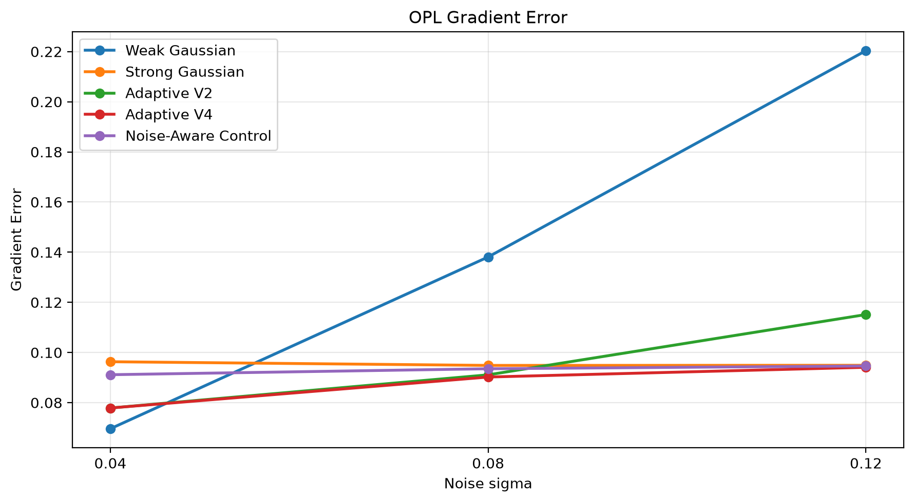

* Evolutia erorii de gradient in regiunea OPL pentru metodele evaluate.*

La zgomot redus, Weak Gaussian obtine cea mai mica eroare de gradient, in timp ce Adaptive V4 obtine o valoare mai mica decat Strong Gaussian si Noise-Aware Control.

La zgomot intermediar si ridicat, Adaptive V4 obtine o eroare de gradient usor mai mica decat metodele Strong Gaussian si Noise-Aware Control.

Aceste rezultate sugereaza ca adaptarea filtrarii poate contribui la conservarea contururilor OPL, insa avantajul depinde de intensitatea zgomotului.

### 5.5.4. Comparatii vizuale

Pentru completarea evaluarii numerice au fost generate comparatii vizuale pentru subiectii de test, la diferite niveluri de zgomot.
In aceste reprezentari sunt comparate imaginea originala, imaginea zgomotoasa si rezultatele obtinute prin metodele de filtrare. Au fost generate si detalii locale ale regiunii OPL, pentru a facilita observarea diferentelor dintre contururi.

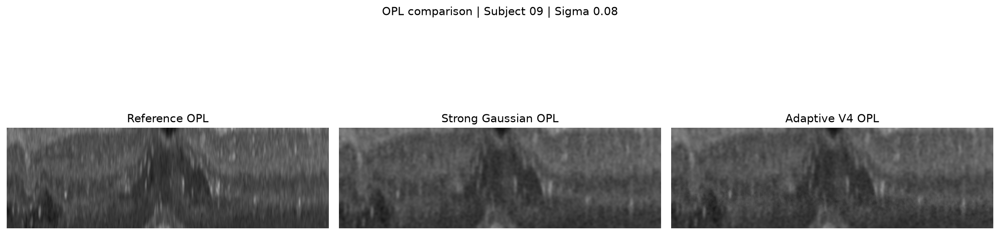

*Comparatie vizuala OCT la nivel intermediar de zgomot.*

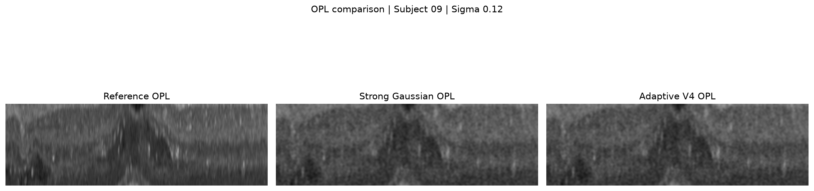

*Comparatie vizuala OCT la nivel ridicat de zgomot.*

Aceste imagini completeaza metricile numerice, permitand examinarea modului in care filtrarea influenteaza aspectul straturilor retiniene.

## 5.6. Analiza comparativa si interpretarea rezultatelor

Rezultatele obtinute pe seturile de date DRIVE si OCT permit evaluarea ipotezei conform careia utilizarea hartilor statistice de probabilitate poate imbunatati conservarea structurilor anatomice fine in timpul reducerii zgomotului.
Deoarece cele doua seturi de date contin structuri anatomice diferite si utilizeaza protocoale experimentale distincte, valorile PSNR nu sunt comparate direct intre DRIVE si OCT. Analiza urmareste diferentele dintre metode in cadrul fiecarui experiment, precum si consistenta imbunatatirilor observate.

### 5.6.1. Analiza statistica a rezultatelor DRIVE

Pentru experimentele DRIVE au fost analizate diferentele dintre metoda Adaptive Smoothed Tuned si doua metode de referinta: Strong Gaussian si Noise-Aware Control.

Analiza a fost realizata pe cele 20 de imagini din setul de test, folosind diferente pereche intre rezultatele obtinute de metode pe aceleasi imagini.
Pentru o metrica precum PSNR, imbunatatirea este definita prin:

$$\Delta_i = \text{PSNR}_{\text{adaptiv},i} - \text{PSNR}_{\text{referinta},i}$$
O valoare pozitiva indica un rezultat mai bun al metodei adaptive.

Au fost calculate imbunatatirea medie, mediana, numarul imaginilor cu rezultate pozitive si intervalele de incredere de $95\%$, estimate prin metoda bootstrap.

| Metrica / Comparatie | Imbunatatire medie | IC 95% | Imagini imbunatatite |
| --- | --- | --- | --- |
| **PSNR vascular** (Strong Gaussian) | +0.093 dB | [0.059, 0.129] | 17/20 |
| **PSNR vascular** (Noise-Aware Control) | +0.040 dB | [0.025, 0.055] | 17/20 |
| **PSNR vase subtiri** (Strong Gaussian) | +0.105 dB | [0.074, 0.139] | 18/20 |
| **PSNR vase subtiri** (Noise-Aware Control) | +0.051 dB | [0.027, 0.074] | 15/20 |
| **PSNR vase groase** (Strong Gaussian) | +0.136 dB | [0.075, 0.205] | 17/20 |
| **PSNR vase groase** (Noise-Aware Control) | +0.021 dB | [0.0004, 0.041] | 13/20 |

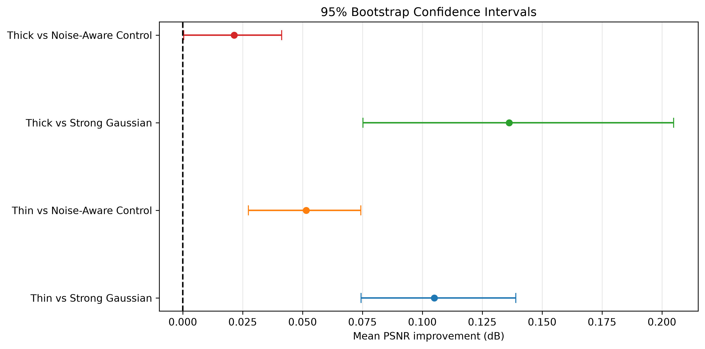

*Imbunatatirile PSNR pentru vasele subtiri si groase, impreuna cu intervalele de incredere de 95%.*

Rezultatele indica imbunatatiri pozitive pentru toate categoriile vasculare analizate.
Pentru PSNR vascular, intervalele de incredere sunt pozitive in ambele comparatii, ceea ce sustine existenta unui avantaj consistent al metodei adaptive pe setul de test.

In cazul vaselor subtiri, imbunatatirea medie fata de Strong Gaussian este de $0.105\text{ dB}$, iar metoda adaptiva obtine rezultate mai bune pe 18 dintre cele 20 de imagini.
Acest rezultat este important pentru obiectivul cercetarii, deoarece vasele subtiri sunt mai vulnerabile la estomparea produsa de filtrarea puternica.

Comparatia cu Noise-Aware Control permite evaluarea contributiei hartii probabilistice. Spre deosebire de metoda adaptiva, aceasta varianta foloseste o pondere constanta, fara a modifica spatial intensitatea filtrarii.
Imbunatatirea de $0.051\text{ dB}$ pentru vasele subtiri sugereaza ca informatia anatomica spatiala aduce un beneficiu suplimentar fata de simpla combinare a celor doua filtre.

Pentru vasele groase, diferenta fata de Noise-Aware Control este mai redusa, de aproximativ $0.021\text{ dB}$, iar intervalul de incredere are limita inferioara apropiata de zero. Prin urmare, avantajul este mai putin pronuntat pentru aceasta categorie.

Pentru evaluarea diferentelor pereche a fost utilizat si testul Wilcoxon. Rezultatele obtinute pentru PSNR vascular sunt:
* Fata de Strong Gaussian: $p = 0.0000477$.
* Fata de Noise-Aware Control: $p = 0.0000629$.
Ambele valori sunt sub pragul conventional de $0.05$, indicand diferente statistice semnificative in cadrul esantionului evaluat.

A fost analizata si eroarea de gradient vascular, pentru care valorile mai mici indica rezultate mai bune.

| Comparatie | Reducere medie a erorii | IC 95% | Valoare p |
| --- | --- | --- | --- |
| **Strong Gaussian** | 0.002461 | [0.001788, 0.003253] | 0.00000381 |
| **Noise-Aware Control** | 0.000328 | [-0.000030, 0.000663] | 0.114 |

Fata de Strong Gaussian, metoda adaptiva obtine o reducere consistenta a erorii de gradient.
In schimb, fata de Noise-Aware Control, diferenta este mai mica, intervalul de incredere include zero, iar valoarea $p$ depaseste pragul de $0.05$.
Prin urmare, aceasta comparatie nu ofera suficiente dovezi statistice pentru a afirma o imbunatatire consistenta a erorii de gradient fata de metoda de control.

### 5.6.2. Analiza variabilitatii rezultatelor OCT

Pentru experimentele OCT a fost analizata diferenta PSNR in regiunea OPL dintre Adaptive V4 si Noise-Aware Control.
Aceasta comparatie este importanta deoarece permite investigarea contributiei adaptarii spatiale bazate pe harta probabilistica, in raport cu o metoda care ajusteaza filtrarea in functie de nivelul zgomotului, dar utilizeaza o pondere spatial constanta.
Diferentele au fost calculate pentru cele 22 de sectiuni OCT valide, la fiecare dintre cele trei niveluri de zgomot.

| Nivel zgomot | Diferenta medie PSNR OPL | Abatere standard | Sectiuni imbunatatite |
| --- | --- | --- | --- |
| $\sigma_n = 0.04$ | +0.8246 dB | 0.4923 | 21/22 |
| $\sigma_n = 0.08$ | +0.1024 dB | 0.1676 | 17/22 |
| $\sigma_n = 0.12$ | -0.0003 dB | 0.0468 | 11/22 |

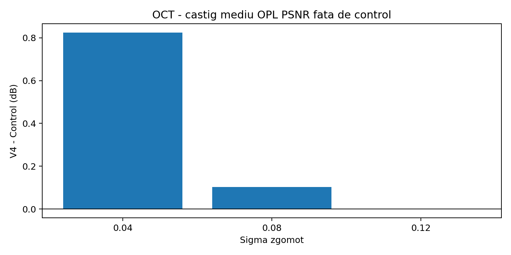

* Diferenta medie PSNR OPL dintre Adaptive V4 si Noise-Aware Control pentru cele trei niveluri de zgomot.*

La nivelul redus de zgomot, metoda Adaptive V4 obtine o imbunatatire medie de aproximativ 0.825 dB. Rezultatele sunt mai bune in 21 dintre cele 22 de sectiuni evaluate.
Aceasta observatie indica faptul ca, atunci cand zgomotul este redus, utilizarea hartii probabilistice permite protejarea mai eficienta a regiunii OPL.

La nivelul intermediar, imbunatatirea medie scade la aproximativ 0.102 dB, iar metoda adaptiva obtine rezultate mai bune in 17 dintre cele 22 de sectiuni.

La nivelul ridicat de zgomot, diferenta medie este practic nula, iar metoda adaptiva obtine rezultate mai bune in 11 dintre cele 22 de sectiuni.
Aceasta evolutie poate fi explicata prin mecanismul de adaptare la zgomot introdus in varianta V4:
$$w(x,y) = P(x,y) \cdot e^{-k\sigma_n}$$

Pe masura ce nivelul zgomotului creste, ponderea filtrarii slabe este redusa, iar rezultatul se apropie de cel obtinut prin filtrarea Gaussiana puternica.
Prin urmare, la zgomot ridicat, contributia hartii probabilistice devine mai mica, ceea ce explica apropierea rezultatelor Adaptive V4 de cele ale metodei de control.

Trebuie mentionat ca cele 22 de sectiuni provin de la numai doi subiecti. Sectiunile aceluiasi subiect nu pot fi considerate complet independente din punct de vedere statistic, astfel incat rezultatele reprezinta o evaluare preliminara si nu permit concluzii ferme privind generalizarea la nivel de pacient.

### 5.6.3. Interpretarea comparativa a rezultatelor

Experimentele DRIVE si OCT evidentiaza comportamente diferite ale filtrarii adaptive, in functie de caracteristicile anatomice ale imaginilor si de intensitatea zgomotului.

In cazul DRIVE, metoda Adaptive Smoothed Tuned obtine imbunatatiri relativ mici, dar consistente, in special pentru vasele sanguine subtiri. In cazul OCT, avantajele variantei Adaptive V4 sunt mai pronuntate la zgomot redus si se diminueaza pe masura ce intensitatea zgomotului creste. Aceste diferente sugereaza ca eficienta adaptarii spatiale depinde atat de distributia structurilor anatomice, cat si de conditiile de degradare a imaginii.

Un aspect comun celor doua experimente este importanta evaluarii separate a regiunilor anatomice de interes. Rezultatele arata ca optimizarea calitatii globale nu conduce intotdeauna la cea mai buna conservare a structurilor fine. Prin urmare, metricile calculate in regiunile vasculare si OPL ofera informatii suplimentare fata de PSNR global.

Din punct de vedere metodologic, comparatiile cu Noise-Aware Control permit investigarea contributiei hartii probabilistice, independent de simpla combinare a doua filtre Gaussiene. Rezultatele indica un beneficiu al adaptarii spatiale in anumite conditii, fara ca acesta sa fie uniform pentru toate imaginile si nivelurile de zgomot.

Comparatia cu metodele existente in literatura ramane una conceptuala, deoarece studiile analizate utilizeaza seturi de date si protocoale experimentale diferite. Rezultatele obtinute evidentiaza potentialul utilizarii informatiilor anatomice statistice pentru ghidarea filtrarii, fara a demonstra superioritatea generala fata de alte metode de reducere a zgomotului.

## 5.7. Limitarile studiului 

Desi rezultatele experimentale indica faptul ca hartile statistice de probabilitate pot contribui la conservarea structurilor anatomice fine, studiul prezinta cateva limitari importante.

### Dimensiunea seturilor de date

Evaluarea DRIVE a fost realizata pe 20 de imagini, iar evaluarea OCT pe 22 de sectiuni provenite de la doar doi subiecti. Aceste dimensiuni limiteaza generalizarea rezultatelor, in special pentru OCT, unde sectiunile aceluiasi subiect nu reprezinta observatii complet independente.

### Utilizarea zgomotului sintetic

Experimentele utilizeaza zgomot Gaussian sintetic, care permite controlul degradarii si calcularea metricilor fata de o imagine de referinta. Totusi, zgomotul real din imaginile medicale poate avea caracteristici diferite, precum zgomotul speckle in OCT sau artefactele specifice imaginilor CT.

### Dependenta de alinierea anatomica

Calitatea hartilor probabilistice depinde de precizia alinierii imaginilor. Alinierea dupa discul optic pentru DRIVE si normalizarea pe doua limite anatomice pentru OCT reduc diferentele dintre imagini, dar nu elimina complet variabilitatea individuala. Erorile de aliniere pot determina protejarea insuficienta a unor structuri fine.

### Variabilitatea anatomica

Hartile probabilistice reflecta frecventa aparitiei structurilor in datele de antrenare, nu localizarea exacta a acestora in fiecare imagine. Astfel, structurile rare sau cu variabilitate anatomica ridicata pot primi probabilitati reduse si pot fi afectate de filtrarea puternica.

### Alegerea parametrilor

Parametrii metodei, precum \(\alpha\), \(k\) si intensitatea filtrelor Gaussiene, au fost selectati experimental. Configuratiile obtinute nu garanteaza performante similare pe alte seturi de date. In plus, varianta Adaptive V4 utilizeaza nivelul cunoscut al zgomotului, care in aplicatii reale ar trebui estimat automat.

### Limitarile evaluarii si generalizarii

Metricile PSNR, SSIM, MAE si eroarea de gradient permit comparatii cantitative, dar nu garanteaza conservarea tuturor detaliilor relevante clinic. Studiul nu include evaluari realizate de specialisti medicali.
De asemenea, metoda a fost validata cantitativ doar pe DRIVE si OCT. Extinderea la imagini CT tridimensionale a fost investigata exploratoriu si necesita experimente suplimentare pe date volumetrice adnotate.
In concluzie, rezultatele sustin potentialul abordarii propuse, dar sunt necesare validari pe seturi de date mai mari, cu zgomot real si variabilitate anatomica mai ridicata, pentru a confirma robustetea si generalizarea metodei.

# 6. Concluzii

## 6.1. Concluziile cercetarii

In cadrul acestei cercetari a fost dezvoltata si evaluata o metoda adaptiva de reducere a zgomotului din imaginile medicale, bazata pe utilizarea unei harti statistice de probabilitate anatomica.

Experimentele realizate pe imaginile OCT si DRIVE au evidentiat potentialul utilizarii informatiei anatomice pentru conservarea structurilor fine. In cazul imaginilor OCT, performanta metodei variaza in functie de nivelul zgomotului, in timp ce pentru imaginile DRIVE au fost obtinute imbunatatiri reduse, dar relativ consistente la nivelul vaselor de sange.

Rezultatele sustin partial ipoteza cercetarii, indicand faptul ca integrarea informatiei anatomice probabilistice poate contribui la conservarea detaliilor, fara a afecta semnificativ calitatea globala a imaginii. Totusi, rezultatele nu demonstreaza o superioritate generalizata fata de metodele clasice de filtrare.

Principala contributie a lucrarii consta in dezvoltarea unei abordari interpretabile, bazate pe informatii anatomice si metode statistice, fara utilizarea retelelor neuronale.

### Raspunsuri la intrebarile de cercetare

-  Utilizarea hartii probabilistice anatomice a permis obtinerea unor imbunatatiri in conservarea structurilor fine, comparativ cu metodele clasice de filtrare, in anumite conditii experimentale.

-  Comparatia cu metoda Noise-Aware Control indica un potential avantaj al utilizarii informatiei anatomice probabilistice. Totusi, diferentele obtinute sunt reduse si necesita validari suplimentare pentru izolarea contributiei acestei informatii.

-  Aplicarea metodei pe imaginile OCT si DRIVE demonstreaza posibilitatea adaptarii acesteia la diferite tipuri de imagini si structuri anatomice. Extinderea la alte modalitati de imagistica medicala necesita investigatii suplimentare.

## 6.2. Posibile imbunatatiri si dezvoltari ulterioare

Metoda propusa poate fi imbunatatita si extinsa prin urmatoarele directii:

- Utilizarea unor seturi de date mai mari si mai diverse
- Imbunatatirea metodelor de aliniere si normalizare anatomica
- Estimarea automata a nivelului de zgomot
- Evaluarea metodei pentru alte tipuri de zgomot
- Optimizarea parametrilor pe seturi de validare independente
- Extinderea metodei la imagini medicale tridimensionale, precum CT si RMN
- Construirea unor harti probabilistice pentru alte structuri anatomice fine

Aceste directii pot contribui la cresterea robustetii metodei si la extinderea aplicabilitatii sale in domeniul procesarii imaginilor medicale.

# Bibliografie

[1] Tao, S., Rajendran, K., Zhou, W., Fletcher, J. G., McCollough, C. H., & Leng, S. (2020). "Noise
reduction in CT image using prior knowledge aware iterative denoising." Physics in Medicine &
Biology, 65, 225032.

[2] Tian, F., Li, Y., Wang, J., & Chen, W. (2021). "Blood Vessel Segmentation of Fundus Retinal
Images Based on Improved Frangi and Mathematical Morphology." Computational and
Mathematical Methods in Medicine, 2021, 4761517.

[3] Fan, L., Zhang, F., Fan, H., & Zhang, C. (2019). "Brief review of image denoising techniques."
Visual Computing for Industry, Biomedicine, and Art, 2, 7.

[4] Douek, P. C., Boccalini, S., Oei, E. H. G., Cormode, D. P., Pourmorteza, A., Boussel, L., Si-Mohamed, S.
A., & Budde, R. P. J. (2023). "Clinical Applications of Photon-counting CT: A Review of Pioneer Studies
and a Glimpse into the Future." Radiology, 309(1), e222432.

[5] Lew, K. L., Kew, C. Y., Sim, K. S., & Tan, S. C. (2024). "Adaptive Gaussian Wiener Filter for CT-Scan
Images with Gaussian Noise Variance." Journal of Informatics and Web Engineering, 3(1), 169–181.

[6] He, Y., Zheng, Y., Zhao, Y., Ren, Y., Lian, J., & Gee, J. (2017). "Retinal Image Denoising via
Bilateral Filter with a Spatial Kernel of Optimally Oriented Line Spread Function." Computational
and Mathematical Methods in Medicine, 2017.

[7] Shi, Z., Ma, J., Zhao, M., Liu, Y., Feng, Y., Zhang, M., He, L., & Suzuki, K. (2016). "Many Is
Better Than One: An Integration of Multiple Simple Strategies for Accurate Lung Segmentation in
CT Images." BioMed Research International, 2016, 1480423.

[8] Lepcha, D. C., Goyal, B., Dogra, A., Vaghela, K., Singh, A., Ravi Kumar, K. S., & Bavirisetti,
D. P. (2025). "Low-dose computed tomography image denoising using pixel level non-local self-
similarity prior with non-local means for healthcare informatics." Scientific Reports, 15, 25095.

[9] Liu, H., Jin, X., Liu, L., & Jin, X. (2022). "Low-Dose CT Image Denoising Based on Improved
DD-Net and Local Filtered Mechanism." Computational Intelligence and Neuroscience, 2022,
2692301.

[10] Li, Z., Shi, W., Xing, Q., Miao, Y., He, W., Yang, H., & Jiang, Z. (2021). "Low-Dose CT Image
Denoising with Improving WGAN and Hybrid Loss Function." Computational and Mathematical
Methods in Medicine, 2021, 2973108.

[11] Moreno López, M., Frederick, J. M., & Ventura, J. (2021). "Evaluation of MRI Denoising
Methods Using Unsupervised Learning." Frontiers in Artificial Intelligence, 4, 642731.

[12] Van Leemput, K. (2009). "Encoding Probabilistic Brain Atlases Using Bayesian Inference."
IEEE Transactions on Medical Imaging, 28(6), 822–837.

[13] Lepcha, D. C., Dogra, A., Goyal, B., Goyal, V., Kukreja, V., & Bavirisetti, D. P. (2023). "A
constructive non-local means algorithm for low-dose computed tomography denoising with
morphological residual processing." PLOS ONE, 18(9), e0291911.

[14] He, Y., Zeng, L., Chen, W., Gong, C., & Shen, Z. (2023). "Bilateral Weighted Relative Total
Variation for Low-Dose CT Reconstruction." Journal of Digital Imaging, 36, 458–467.

[15] Yeoh, H., Hong, S. H., Ahn, C., Choi, J.-Y., Chae, H.-D., Yoo, H. J., & Kim, J. H. (2021).
"Deep Learning Algorithm for Simultaneous Noise Reduction and Edge Sharpening in Low-Dose
CT Images: A Pilot Study Using Lumbar Spine CT." Korean Journal of Radiology, 22(11), 1850–1857.

[16] Staal, J., Abràmoff, M. D., Niemeijer, M., Viergever, M. A., & van Ginneken, B. (2004). Ridge-based vessel segmentation in color images of the retina. IEEE Transactions on Medical Imaging, 23(4), 501–509.
Dataset: https://drive.grand-challenge.org/

[17] Chiu, S. J., Allingham, M. J., Mettu, P. S., Cousins, S. W., Izatt, J. A., & Farsiu, S. (2015). Kernel regression based segmentation of optical coherence tomography images with diabetic macular edema. Biomedical Optics Express, 6(4), 1172–1194.
Dataset: https://people.duke.edu/~sf59/Chiu_BOE_2015_dataset.htm

[18] Hu, Q., Abràmoff, M. D., & Garvin, M. K. (2015). Automated separation of binary overlapping trees in low-contrast color retinal images. Medical Image Analysis, 21(1), 1–13.
